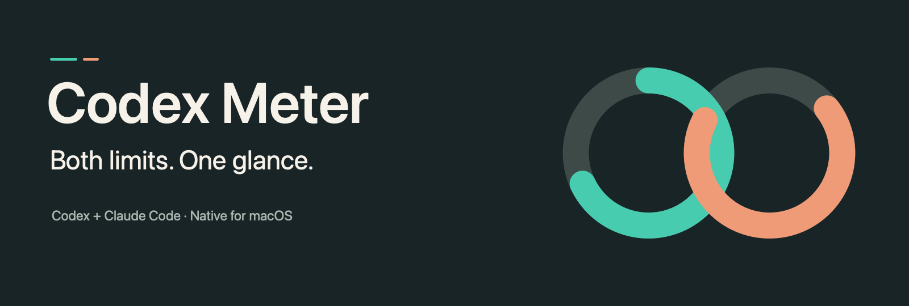
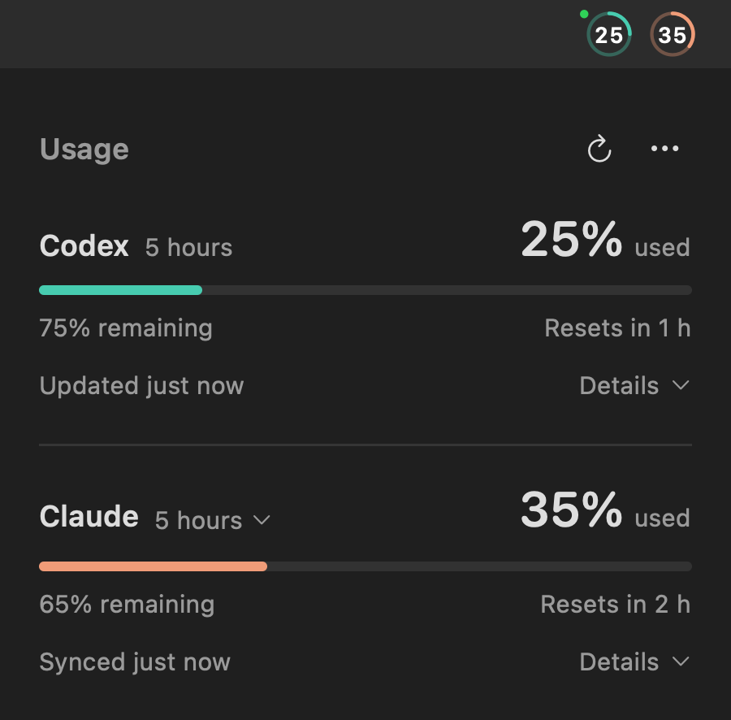
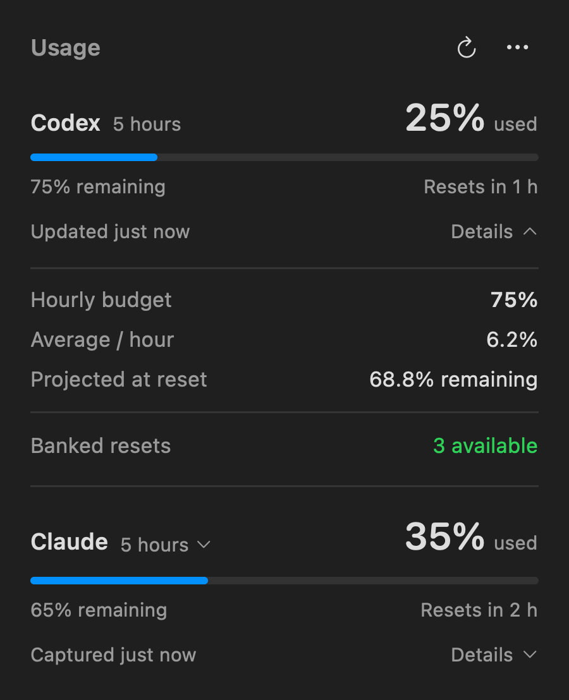

# Codex Meter

A small native macOS menu bar app for keeping Codex and Claude Code quota in view.

- **Two compact rings:** Codex on the left, optional Claude on the right, with consumed quota inside each ring.
- **One shared overview:** both service rows stay visible, with remaining quota, reset countdowns and independent freshness.
- **Details when needed:** daily or hourly allowance, today's budget, average quota pace, recent credit consumption and credit runway.
- **Codex reset announcements:** an unread cue and a link in Details to Tibo’s latest post mentioning **reset**.
- **Stay up to date:** optional launch at login and quiet checks for new app releases.
- **Lightweight:** AppKit + SwiftUI, Sparkle bundled for signed in-app updates. The Codex reader runs only during refreshes.



The preview shows both services with synthetic quota values, not actual account usage. The PNG is rendered directly at 3× resolution and displayed at the panel’s native width for crisp text. Reproduce it with `./scripts/test-ui.sh --render-only` (`.build/readme-demo.png`).

<details>
<summary>Budget and provider details</summary>



</details>

See the [0.7.0 release notes](docs/releases/0.7.0.md) for the new overview and Claude setup.

This is an independent project, not affiliated with OpenAI or Anthropic.

## Login & privacy

Sign in with the official Codex CLI using ChatGPT before opening Meter. You do not give Codex Meter an account, password or API key. The CLI account may be different from the account signed in to the Codex desktop app; Meter reads whichever account the CLI uses. API billing is outside Meter's scope.

Meter asks the locally launched CLI for quota and reset information through `account/rateLimits/read` over standard input/output. It also reads `account/read` to keep credit observations scoped to a personal account, then closes that process. The app has no Meter backend or telemetry code. Codex snapshots and up to 30 minutes of credit-balance observations stay in memory. Display preferences, each service's selected quota window, automatic-update and reset-post preferences plus the last-read post ID are saved. Codex CLI manages its own network access, authentication and any logs it writes.

Optional Claude support receives quota through a small local plugin for Claude Desktop's Code tab, or a status-line bridge for terminal Claude Code. Both save only the most recently received quota windows and capture time in a private local file; they do not read Claude credentials, transcripts or account identity. See [Claude setup and storage](docs/INSTALL.md#optional-claude-code-support).

Meter can use a standalone Codex CLI or the CLI bundled with the Codex desktop app. It checks the desktop app directly if a standalone CLI path is unavailable, including when an app update leaves an old symlink behind.

The displayed percentages are quota points, not token counts. Budget allowance is remaining quota divided by time to reset; runway and reset projections assume the current average pace. These figures are not a history of actual usage or a measure of productivity.

## Install

You need an **Apple Silicon Mac**, macOS **13 or later**, and the **Codex CLI signed in with ChatGPT**.

1. Open the [latest release](https://github.com/emmepra/codex-meter/releases/latest) and download the **Apple Silicon ZIP** under **Assets**.
2. Unzip it and move **Codex Meter.app** to your Applications folder.
3. Open the app. No compiler or source checkout is needed.

The app is **ad hoc signed**, without an Apple Developer ID signature or notarization, so Gatekeeper may block the first launch. The [installation guide](docs/INSTALL.md#first-launch) explains Apple's **Open Anyway** procedure, along with [CLI setup](docs/INSTALL.md#install-codex-cli-and-sign-in), [building from source](docs/INSTALL.md#build-from-source-alternative), updates and troubleshooting.

### Updating an existing installation

From **0.5.3**, choose **Options → Check for Updates…**, then download and install from the update window. The app relaunches after installation. **Versions 0.5.2 and earlier need one manual upgrade**: download the ZIP, quit Meter, and replace the copy in Applications. Keep the app in Applications rather than running it from a downloaded archive.

Automatic checks show **Install <version>…** in Options when a newer release is available. The menu-bar dots are reserved for reset credits and unread Tibo posts. Older versions without an update command can use the [latest release page](https://github.com/emmepra/codex-meter/releases/latest).

## Use

Click the menu bar indicator to open the compact **Usage** panel, anchored directly below the menu bar even when its content changes height. Codex and enabled Claude each have a visible row with the service name, quota period, **used quota**, consumption bar, remaining quota and reset countdown. **Ring only** hides the numbers inside the menu-bar rings. Each service has its own **Details** control; opening one closes the other. Details contains budget and pace estimates, with credit balance, banked resets and Tibo posts inside Codex Details. Compact cues surface conditions needing attention without expanding the full detail sections.

The **Options** (`…`) menu contains **Ring only**, **Show Claude**, **Set Up Claude…** when Claude is enabled, **Check for Updates…**, **Open Repository** and **Quit**. When a service supplies several quota windows, its visible period label opens the window menu. Each service remembers its selection. Codex usage refreshes every three minutes and after wake; the shared header's refresh button reads Codex and the latest Claude capture immediately. **Launch at Login** in Options enables the native macOS login item; it is off until you choose it. If macOS requires approval, use **Approve Launch at Login…**. Keep the app in Applications. Login launches stay in the menu bar without opening the panel.

### Codex and Claude together

**Show Claude** is off by default. Enable it after [connecting Claude Code](docs/INSTALL.md#optional-claude-code-support) to show two compact rings in one menu-bar item: Codex on the left and Claude on the right. Names stay in the panel and tooltip. Both show **used quota**; an exclamation mark replaces a number when that provider’s data is uncertain. The panel keeps both service rows visible, so no service switch is needed to compare remaining quota and reset times. With Claude disabled, the same panel shows one Codex row. An unavailable or old Claude reading does not change Codex's state.

Claude Desktop's local Code sessions use a bundled plugin built on the official [mods API](https://code.claude.com/docs/en/plugins/mods/reference). Terminal sessions can use the official [status-line interface](https://code.claude.com/docs/en/statusline#rate-limit-usage). A terminal status-line setting alone does not connect Desktop. Both routes feed the same five-hour and weekly quota view. The plugin needs a compatible embedded Claude Code version and must load in the session; see [setup and activation](docs/INSTALL.md#optional-claude-code-support).

The app shows the latest local capture, not an independent server poll. Missing windows remain unavailable; captures older than ten minutes pause estimates, and an elapsed reset waits for new data. **Unavailable** is distinct from a reported zero. Several sessions share the latest capture without identifying its account. Codex credit balances, banked resets and Tibo posts stay in Codex Details; Claude has no equivalent rows. Live Desktop Code capture has been checked with embedded Claude Code 2.1.309. A complete reset cycle, terminal-session capture and broader version coverage remain unverified.

The existing app name, preferences and update path are retained. See [provider design and verification](docs/PROVIDERS.md).

**Banked resets** in Codex Details shows the number of banked resets available to the Codex CLI account, including a confirmed zero. A fresh positive count is green; zero is red. Out-of-date counts remain orange, while **Unavailable** stays neutral and does not mean zero. **Out of date** marks a retained count after a failed refresh or more than ten minutes without an update. This account-level count is separate from the scheduled **Resets in** countdown and does not imply that a window is eligible for redemption. Redeem resets in Codex; Meter only displays availability.

### Compact menu bar and project links

With Codex alone, the menu bar shows the used quota as a number inside the ring (the percent sign is omitted for readability). Two independent corner dots surround the Codex ring: green at top left for fresh positive reset availability, and amber at bottom right for an unread Tibo post mentioning **reset**. App updates do not light a dot. They can appear together. Missing, zero or stale reset counts never produce a green dot. Options shows **Install <version>…** when a release is available. Credits do not add a number or indicator to the menu bar. The tooltip includes the exact reset count and credit balance when available. Ring-only mode hides the number, retaining the reset and unread-post indicators.

The shared **Usage** header holds refresh and Options. Each service shows relative freshness: **Updated** for a Codex read and **Captured** for data received from Claude Code. Hover for the exact time and source explanation. These remain separate from the scheduled reset countdown. Budget values use the system primary text color for light and dark appearance. The app bundle includes a dedicated meter icon, also used in update dialogs.

**Automatically Check for Updates** is on by default. It checks the latest stable GitHub release at app launch and then at most every six hours while running, including after wake. Disable it in Options for manual-only checks. Automatic checks are silent, including network failures. **Check for Updates…** still checks immediately and displays the result. It sends no quota or account data. From version 0.5.3, **Check for Updates…** or **Install <version>…** opens the native Sparkle update window. Confirm the download and installation there; Sparkle verifies the signed feed and archive, replaces the app and relaunches it. Installation always requires your confirmation.

### Credits

When the service supplies credit metadata, **Codex Details** shows the available balance separately from included quota and banked resets. A numeric zero, **Unlimited**, **Unavailable** and **Out of date** are distinct states. Credits remain a balance, without a percentage: the CLI does not supply a reliable total for that calculation. The menu-bar ring continues to show used quota and never appends a credit balance.

**Credits in use** appears only when fresh readings belong to a known personal account, a Codex quota window is exhausted, and the balance has decreased in the last ten minutes. It signals observed balance consumption, not which task was billed; expirations or other adjustments can also lower the balance. An exhausted quota with available credits alone does not activate it. The balance remains available in Details while included quota is still available, without suggesting that credits are being used.

With a zero credit balance, Details shows the balance and omits rate/runway estimates. For a positive balance, **Details** shows **Recent consumption**, the positive net balance decrease per hour over up to 30 minutes of continuous readings, after at least 15 minutes and three samples with a fresh latest reading. **Credit runway** divides the remaining balance by that rate. Observations follow the credit balance independently of quota usage: reaching 100% or returning to included quota does not restart the window. The ten-minute recent-decrease rule applies only to the **Credits in use** cue, not to these statistics.

Details shows **Estimating…** while history is insufficient and **Awaiting balance updates** when the rolling window has no positive decrease. A balance increase, gap longer than ten minutes, failed read, missing numeric balance or change of personal account restarts observations. Stale readings do not produce estimates. Samples are kept only while Meter runs, so restarting starts a new window. These are recent balance observations and constant-pace estimates, not a per-chat ledger, exact billed spend or a countdown of productive work.

The CLI supplies account identity; Meter retains only an in-memory fingerprint and never saves email or credentials. Credit pace requires fresh metadata, an email and a recognized individual plan. Workspace balances can still be shown, but pace estimates remain unavailable until a reliable workspace scope is exposed. No token-to-credit or monetary conversion is inferred.

### Reset posts from Tibo

**Check Tibo’s Reset Posts** in Options is on by default. Meter reads the public RSS feed at `https://x.noodl3.net/thsottiaux/rss` at launch and every 30 minutes, with a due check after wake. This is a third-party Nitter instance, not an official X/OpenAI service; it may be unavailable, delayed or incomplete. The source sees ordinary connection metadata such as the IP address, but Meter sends no account data, quota, cookies or credentials. No X API key, Python runtime or new library is required.

Codex Details shows **𝕏 Tibo** and the date of the newest matching post in the last seven days. It matches the standalone word **reset**, case-insensitively, after removing URLs, and checks the author and post link. Posts from other authors and reposts are ignored. A keyword match does **not** confirm a reset on your account.

**New in 0.5.1:** a short excerpt appears below the author, with **reset** in bold and ellipses where context is omitted. It keeps whole words, uses up to 72 characters and wraps to at most two lines. For example, using synthetic text:

> … we will **reset** usage limits tomorrow …

- **Read:** recent dates show **Today** or **Yesterday**. Hover for the full date, time and excerpt; click to open the original post on X.
- **Dismiss:** opening the post, clicking its **Mark as seen** checkmark or choosing **Mark Tibo Post as Read** clears the amber dot across restarts. A newer matching post lights it again.
- **Reset-count change:** an increase between two fresh successful quota reads after detecting the post also clears the dot; the link stays visible. Reads must be at most ten minutes apart. This is a dismissal heuristic, not proof that the post caused a reset. An initial positive count, missing/failed reads or a long gap do not establish a connection.
- **Source unavailable:** retained matches are marked **cached** after a failed refresh. **Tibo posts unavailable** distinguishes a failed source without a cached match from no recent match.
- **Control and storage:** disable **Check Tibo’s Reset Posts** to stop fetching and hide the row. Post contents and quota comparisons stay in memory; only the last-read post ID and the feature preference are saved.

### What the statistics mean

These supporting statistics are in each service's collapsible **Details** section.

| In the app | Meaning |
| --- | --- |
| Daily budget / Hourly budget | Remaining quota divided by time until reset. |
| Today, from now | The share of that budget available from now to local midnight. |
| Average / day or / hour | Current consumption divided by elapsed time in the quota window. |
| Runway at this pace | Estimated time to exhaustion at that average pace. |
| Projected at reset | Estimated quota left at reset, shown when the current average pace would leave quota available. |

Percentages are **points of the whole window's quota**. For example, 75% remaining with 3.5 days until reset gives a daily allowance of about **21.4%**.

The window's start is inferred from its duration and reset time. Projections assume a constant pace; they are not measured daily history or a prediction of future work. Estimates wait for enough of the window to elapse, and pause when data is stale or a reset is awaiting confirmation. Missing values are never displayed as zero.

## How it works

Codex Meter starts a short-lived `codex app-server` process and reads `account/read` and `account/rateLimits/read` through its documented local protocol. It uses the CLI's existing login, starts no model turns and never consumes reset credits. If desktop and CLI use different accounts, the app follows the CLI account.

Codex snapshots stay in memory; the optional Claude bridge keeps one sanitized local snapshot. Display, provider, automatic-update and reset-post preferences plus the last-read post ID are saved by the app; macOS manages the login item. Authentication remains with the official CLIs; no tokens are copied into this project.

See the [official Codex App Server documentation](https://learn.chatgpt.com/docs/app-server#6-rate-limits-chatgpt). Compatibility has been checked with Codex CLI 0.153.0.

The reset-count field has been verified in the generated protocol schema for CLI 0.155.0-alpha.16, with synthetic payload tests. Its earliest supported stable CLI version and live availability across accounts have not been verified. Older CLIs that omit the field continue to show ordinary quota data, with reset availability shown as **Unavailable**.

## Develop

```sh
./scripts/test.sh       # Offline model, budget, geometry and process-lifecycle tests
./scripts/test-ui.sh    # Native window layout checks; briefly shows synthetic UI
./scripts/build.sh      # .build/Codex Meter.app
".build/Codex Meter.app/Contents/MacOS/CodexMeter" --check  # Live read, no UI
```

Source is split into the menu bar UI and panel positioning, CLI client, usage decoder and budget calculations under `Sources/`. Tests use synthetic data and local stub processes; they do not need a Codex login or network access. The optional UI tests require a logged-in macOS desktop and check actual window coordinates after content growth, shrinkage and menu bar item movement.

The Desktop plugin tests require Node.js; no npm packages are needed. For a synchronized checkout whose Finder metadata interferes with signing, set `METER_BUILD_DIR` to a local temporary directory before running `scripts/build.sh`.

Builds target macOS 13+ and have been tested locally on macOS 26.6.2. A complete live reset cycle and older macOS releases have not yet been exercised.

See [security boundaries and review](docs/SECURITY.md) for the trust model and known limitations.

## Contributing

Use an [issue](https://github.com/emmepra/codex-meter/issues/new/choose) to report a bug or propose a change. Include the macOS and Codex CLI versions in bug reports.

To contribute code, fork the repository, create a branch and open a pull request. Changes go through maintainer review and CI before merging. See [CONTRIBUTING.md](CONTRIBUTING.md) for the steps and checks.

## Releases

Versioning, packaging and the tag-triggered GitHub Actions workflow are described in the [release guide](docs/RELEASING.md).

## License

[MIT](LICENSE). The README banner was generated with AI; its [prompt and provenance](assets/banner-prompt.md) are included.
