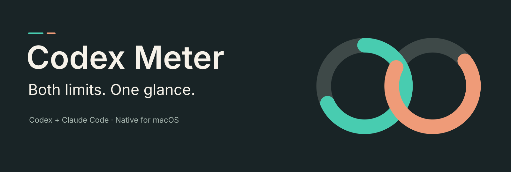

A native macOS menu-bar app for monitoring **Codex and Claude Code** quota in one place.

**[Download the latest release](https://github.com/emmepra/codex-meter/releases/latest) · [Install guide](docs/INSTALL.md) · [Usage guide](docs/USAGE.md)**

The visual refresh shown here is in the current source; the latest packaged release is [0.7.1](docs/releases/0.7.1.md).


Synthetic values, not account usage. [See expanded Details](assets/codex-meter-details.png).

- **Recognizable at a glance.** Teal for Codex, terracotta for Claude; show both rings or either one.
- **Compare without switching.** Quota used, remaining share, reset countdown and freshness stay visible for each monitored service.
- **Open Details when needed.** Budget and pace estimates, plus Codex credits, banked resets and reset-post notices.
- **Small and native.** AppKit + SwiftUI, optional launch at login and signed in-app updates through Sparkle.

## Install

You need **Apple Silicon**, **macOS 13+** and the **Codex CLI signed in with ChatGPT**. Meter can also use the CLI bundled with the Codex desktop app.

1. Download the Apple Silicon ZIP from the [latest release](https://github.com/emmepra/codex-meter/releases/latest).
2. Unzip it and move **Codex Meter.app** to Applications.
3. Open Meter; no compiler or source checkout is needed.

The app is **ad hoc signed, without Apple Developer ID notarization**. If Gatekeeper blocks it, follow the [Open Anyway instructions](docs/INSTALL.md#first-launch). The install guide also covers [CLI setup](docs/INSTALL.md#install-codex-cli-and-sign-in), [building from source](docs/INSTALL.md#build-from-source-alternative) and [updates](docs/INSTALL.md#update).

### Connect Claude Code

In the current source, enable **Options → Monitor Claude** to read the signed-in CLI account’s subscription quota even when all Code sessions are closed. The direct reader uses Claude Desktop’s embedded CLI and has been verified with version **2.1.317**.

For the packaged 0.7.1 release, or as a fallback when direct reads are unavailable, choose **Set Up Claude… → Enable Bridge**. In Desktop Code, run `/reload-plugins` or open a new local Code session. See [bridge setup and terminal support](docs/INSTALL.md#optional-claude-code-support).

**Upgrading from 0.7.0 to 0.7.1 with Claude Desktop?** Run **Set Up Claude…** once and reload/start the Code session to install bridge **0.1.1**. Updating the app alone does not replace the separately installed plugin.

## Use

Click a ring to open the overview. The numbers show **used quota**; each row also shows remaining quota and its reset countdown.

- **Options → Menu Bar** remembers **Codex and Claude**, **Codex only** or **Claude only**. This changes the rings; the panel retains every monitored service.
- **Monitor Claude** controls tracking. Choosing a menu-bar mode containing Claude enables it; choosing Codex only leaves existing Claude tracking on. Turning monitoring off returns the menu bar to Codex.
- Choose a period from its label when several quota windows are available. Each service remembers its choice.
- Open a row's **Details** for estimates; opening one closes the other. **Ring only** hides ring numbers.

Missing quota stays unavailable, distinct from a reported zero. Out-of-date data and unconfirmed resets pause estimates; each service has its own state.

**Updated** identifies a successful Codex or Claude CLI read. Meter requests usage at launch, every three minutes, after wake and on manual refresh. **Synced** identifies a local Claude Desktop bridge check. **Captured** identifies a terminal or older snapshot. Hover for the source and timestamps.

For [quota calculations](docs/USAGE.md#what-the-statistics-mean), [credit estimates](docs/USAGE.md#credits), [banked resets](docs/USAGE.md#banked-resets) and [Tibo notices](docs/USAGE.md#reset-posts-from-tibo), use the detailed usage guide.

## Privacy

Sign-in stays with the official CLIs. Meter does not ask for passwords or API keys, read Claude credentials, start model turns or redeem resets. **API billing is outside its scope.**

There is no Meter backend or account/quota telemetry. Direct CLI readings and recent Codex credit observations stay in memory. The optional Claude bridge keeps one private sanitized quota snapshot with source and local times. Display preferences are saved. Optional update and RSS checks contact public sources without sending account or quota data. The CLIs manage their own authentication, network access and logs.

See [data sources and compatibility](docs/USAGE.md#data-sources-and-compatibility), [Claude storage](docs/INSTALL.md#reading-freshness-and-removal), [provider design](docs/PROVIDERS.md) and [security boundaries](docs/SECURITY.md). This independent project is not affiliated with OpenAI or Anthropic.

## Develop and contribute

```sh
./scripts/test.sh                  # Offline tests; Node.js needed for plugin tests
./scripts/test-ui.sh --render-only # Synthetic overview and Details images
./scripts/build.sh                 # .build/Codex Meter.app
```

Full UI checks use `./scripts/test-ui.sh` in a logged-in macOS desktop. For a synchronized checkout whose Finder metadata interferes with signing, set `METER_BUILD_DIR` to a local temporary directory before building.

Read [CONTRIBUTING.md](CONTRIBUTING.md) for issues, pull requests and required checks, and the [release guide](docs/RELEASING.md) for packaging. Screenshots and test fixtures use synthetic data; [verification limits](docs/PROVIDERS.md#remaining-scope) remain explicit.

[MIT license](LICENSE) · [Artwork provenance](assets/banner-prompt.md).
