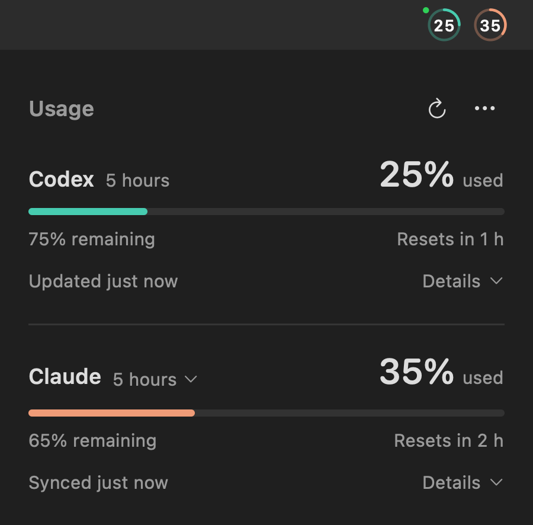

Codex Meter 0.7.0 brings Codex and Claude Code quota into one compact menu-bar app.

- Enable **Show Claude** for two adjacent rings: Codex on the left, Claude on the right. Each shows consumed quota; an uncertain reading is marked independently.
- Open **Usage** to compare both service rows together, including remaining quota, reset countdowns and relative freshness. Choose each quota window from its period label.
- Expand one service's **Details** at a time for budget and pace estimates. Codex credits, banked resets and Tibo reset posts stay in Codex Details, with compact cues for conditions needing attention.
- Connect local Claude Desktop Code sessions through the bundled plugin, or terminal Claude Code through a status-line bridge. Setup preserves unrelated configuration and backs up files before changes. Authentication stays with Claude Code; Meter does not read credentials or start model tasks.
- Keep unavailable, reported zero, out-of-date and reset-unconfirmed states distinct. Claude **Captured** time describes local receipt, not an independent server poll.

## Update and install

From **0.5.3**, choose **Options → Check for Updates…** and confirm installation in the native update window. **Versions 0.5.2 and earlier need one manual upgrade:** download **Codex-Meter-0.7.0-macos-arm64.zip**, quit Meter and replace the copy in Applications. Existing Codex preferences and the app's update path are retained; Claude is off until enabled.

Requires **Apple Silicon, macOS 13+**, and a **Codex CLI signed in with ChatGPT**. Optional Claude Desktop support needs a local session in its **Code** tab and embedded Claude Code **2.1.299+**. Enable **Show Claude**, choose **Set Up Claude…**, then reload plugins or open a new Code session. Plain Claude Desktop chat, Cowork and remote/cloud sessions are outside this integration.

## Verification and privacy

The overview was checked locally with real Codex and Claude Desktop Code readings; Claude capture was verified with embedded CLI **2.1.309**. Offline tests, synthetic light/dark rendering and plugin validation passed. A complete reset cycle, terminal-session capture and broader version coverage remain unverified.

The Claude bridge stores one sanitized local quota snapshot and capture time, without prompts, transcript paths, session/account identifiers or credentials. Several sessions share the latest capture. The app remains **ad hoc signed and not notarized by Apple**; signed in-app updates do not replace Developer ID notarization. See the [installation guide](https://github.com/emmepra/codex-meter/blob/v0.7.0/docs/INSTALL.md) for setup, storage, removal and first launch.
