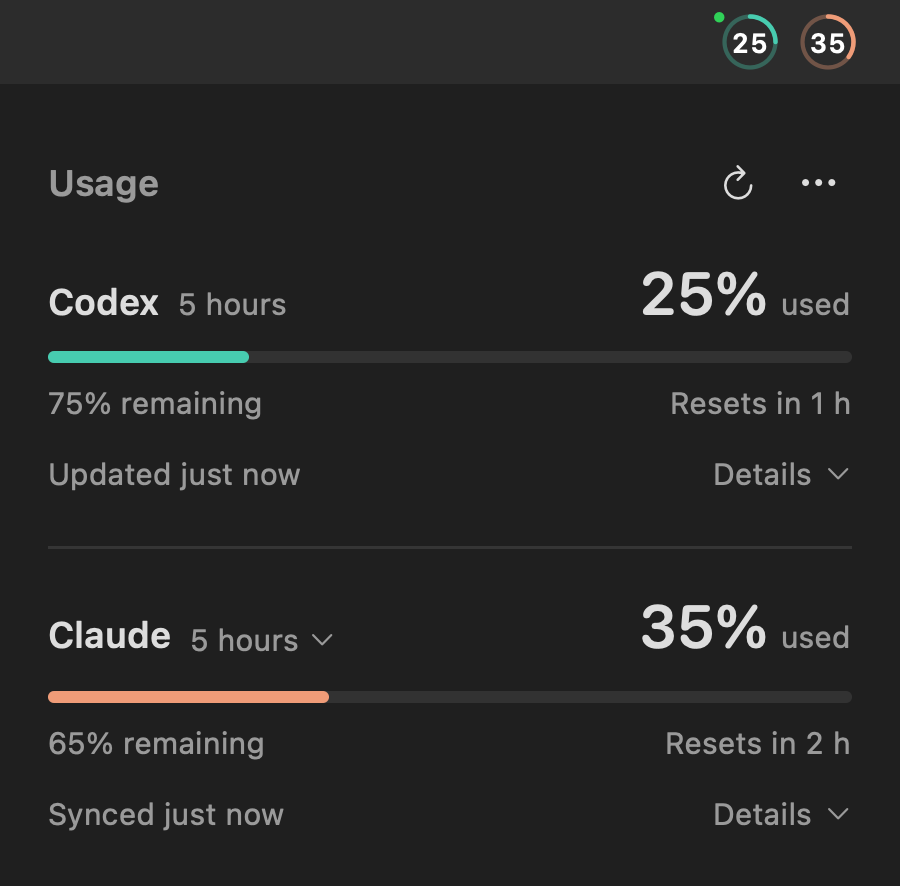

Codex Meter 0.7.1 makes the menu-bar rings easier to identify and keeps the local Claude Desktop connection synchronized between turns.

- Codex uses teal and Claude terracotta, with matching panel bars and neutral digits.
- **Options → Menu Bar** remembers **Codex and Claude**, **Codex only** or **Claude only**, independently of monitoring. The panel keeps monitored service rows visible; **Monitor Claude** controls Claude tracking.
- Desktop bridge **0.1.1** checks Claude Code's cached usage every 60 seconds and on attach, alongside startup and measurement events. **Synced** reports the local connection check; unchanged cached data does not advance the quota-observation time or imply a fresh server response. No model turns or direct network requests are added.
- Guard against older idle-session caches overwriting newer quota or its timestamps. Local writes use a private, bounded file lock and atomic replacement.
- Fix bridge setup when the plugin is already enabled and update an older installed plugin version correctly.

## Upgrade

Existing preferences and connection settings are retained. Choose **Options → Check for Updates…**. For a manual upgrade, download **Codex-Meter-0.7.1-macos-arm64.zip**, unzip it, quit Meter and replace the app in Applications.

**Upgrading from 0.7.0 with Claude Desktop:** run **Options → Set Up Claude…** once, then `/reload-plugins` in the local Code session or open a new one. Updating the app alone does not replace the separately installed bridge. This step installs bridge **0.1.1**.

Requires **Apple Silicon, macOS 13+**, and a **Codex CLI signed in with ChatGPT**. The app remains ad hoc signed and not Apple-notarized. See the [installation guide](https://github.com/emmepra/codex-meter/blob/v0.7.1/docs/INSTALL.md).

## Verification

Offline tests, feature CI, build and strict signature verification passed. Synthetic rendering, native appearance, all three display modes and relaunch were checked. The geometry harness run was interrupted by app deactivation; a complete reset cycle, terminal capture and broader version coverage remain unverified.
